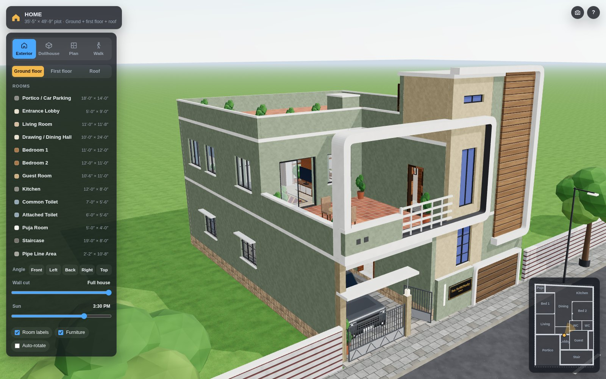
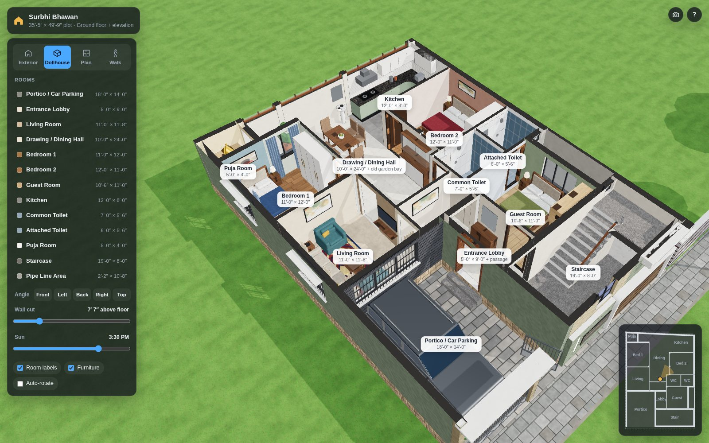
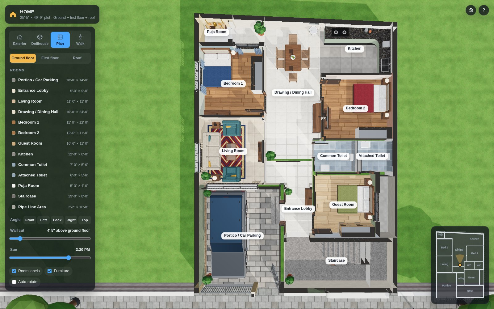
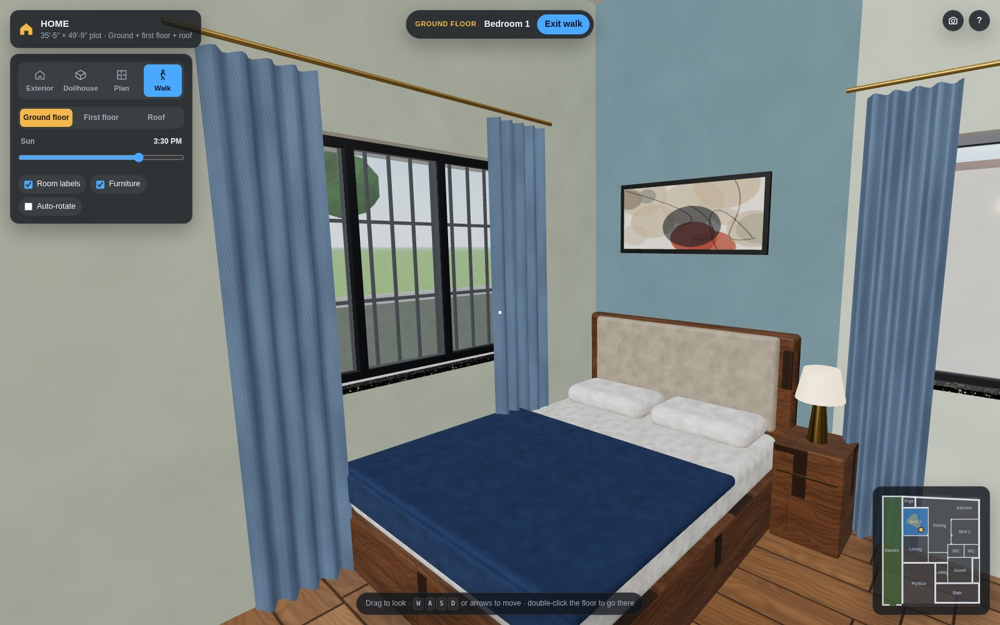
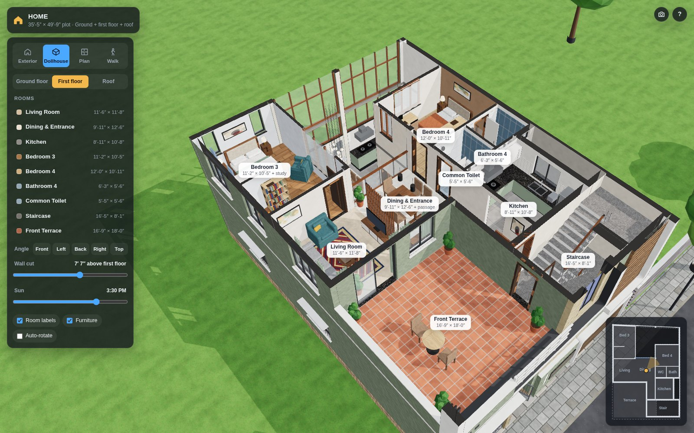
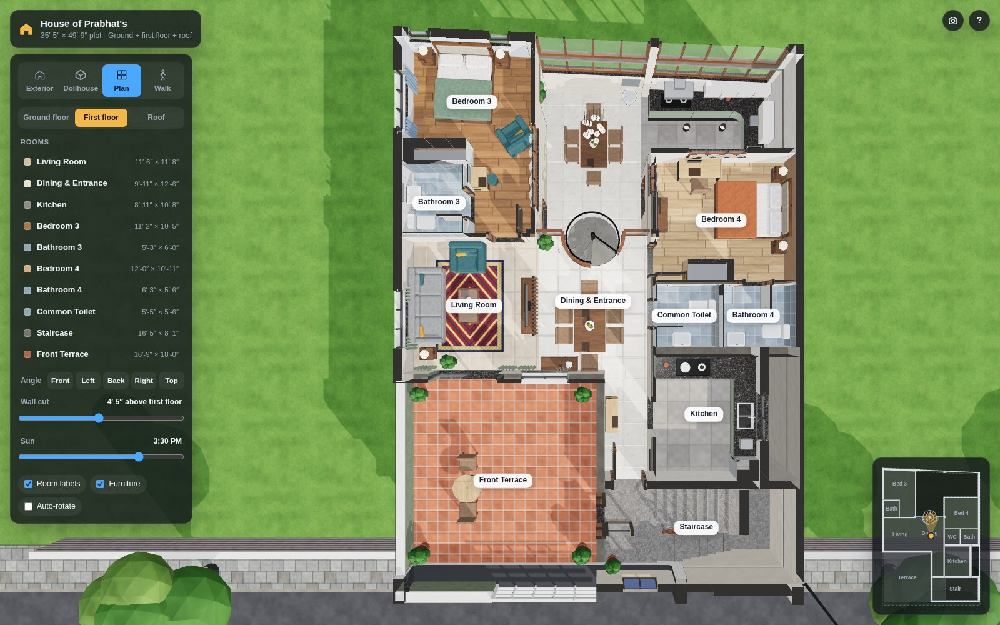
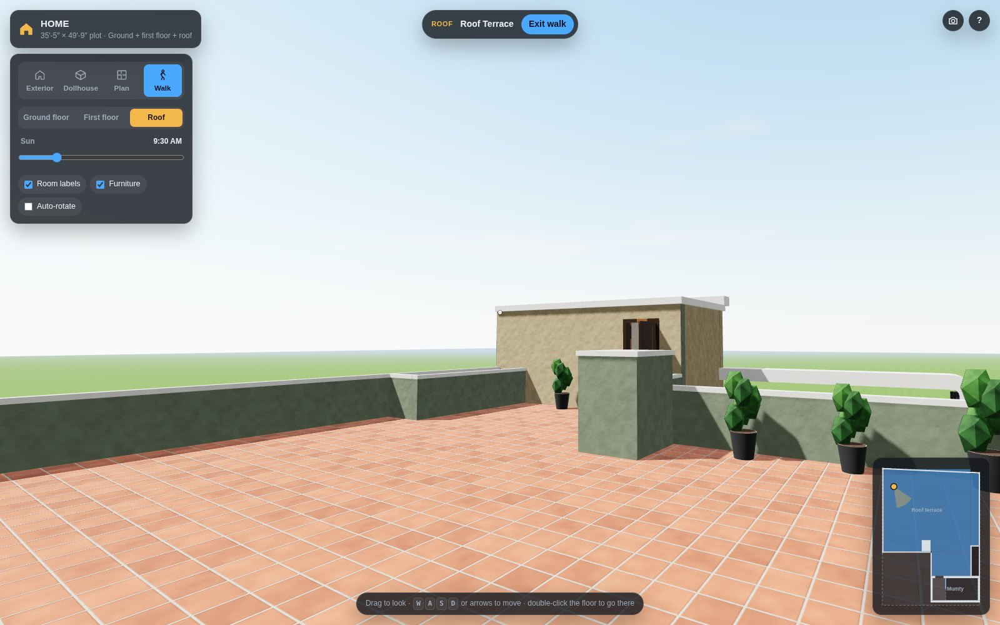
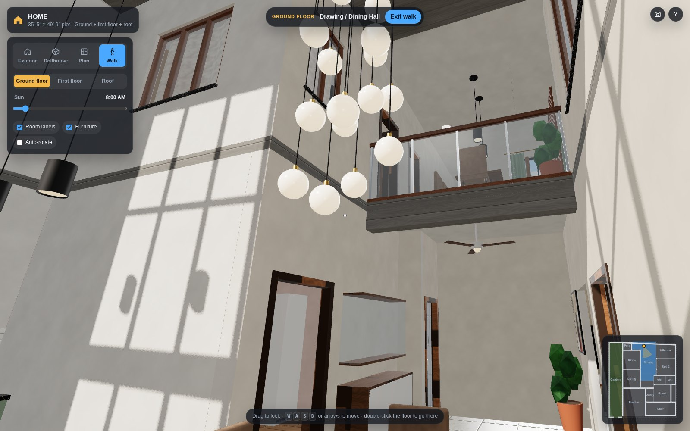
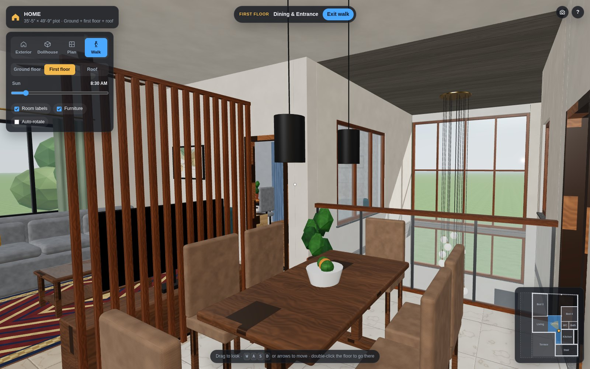

# HOME — 3D home viewer

An interactive, textured 3D model of a 35′-5″ × 49′-9″ house, built from the
supplied ground-floor plan and dressed with the front elevation's facade, with a proposed 2BHK
flat on the first floor and a walkable roof terrace. Made with **three.js** (WebGL) and plain
HTML/CSS/JavaScript.

**Live site:** https://pspk001.github.io/home/



| Dollhouse cut-away | Plan view | Walk-through |
|---|---|---|
|  |  |  |

| First floor (2BHK) | First-floor plan | Roof terrace |
|---|---|---|
|  |  |  |


*The dining hall and kitchen rise double height, overlooked by the first-floor dining area across a glass railing. Along the back the wall is solid up to door height, with a tall glass wall above it facing the sunrise.*


*Upstairs, the dining table of the first-floor flat stands at the railing, with the living room behind a slatted teak screen.*

---

## Open it (no install)

Double-click **`Home-3D-Viewer.html`**. It is one self-contained file (~780 KB) with all code,
styles and textures inside, so it works offline in any recent Chrome, Edge, Safari or Firefox
(WebGL 2 required). It also works on phones and tablets.

## What you can do

| Control | What it does |
|---|---|
| **Exterior** | Orbit around the house: drag to rotate, scroll / pinch to zoom, right-drag / two fingers to pan |
| **Ground floor / First floor / Roof** | Choose the level to look at. The room list, labels and minimap follow it, and the dollhouse and plan views slice the walls just above that floor |
| **Dollhouse** | Walls sliced at 7′-7″ above the chosen floor so every room is visible from above, from any angle |
| **Plan** | Top-down view of the chosen floor, with furniture |
| **Walk** | First-person tour: drag to look, <kbd>W</kbd><kbd>A</kbd><kbd>S</kbd><kbd>D</kbd> / arrows to move (<kbd>Shift</kbd> to run), double-click the floor to walk there. The stairs climb from the ground floor to the first floor and on to the roof, and you can walk out onto the front terrace and the roof terrace. On phones use the on-screen joystick |
| **Rooms list / labels / minimap** | Click any room to fly into it. The info card shows level, size, area, floor finish and a **Walk inside** button |
| **Angle** | One-click Front / Left / Back / Right / Top views |
| **Wall cut** | Slice the whole house at any height (from 1 ft above the floor up to the full house) |
| **Sun** | Move the sun from 7 AM to 6:30 PM (shadows update). As on site, it rises behind the house and sets over the road |
| **Room labels / Furniture / Auto-rotate** | Toggles |
| 📷 | Save the current view as a PNG |

Keyboard: <kbd>1</kbd>–<kbd>4</kbd> views · <kbd>PgUp</kbd> / <kbd>PgDn</kbd> floor up / down · <kbd>L</kbd> labels · <kbd>F</kbd> furniture · <kbd>R</kbd> auto-rotate · <kbd>Esc</kbd> back.

## Tech stack

| Layer | Used |
|---|---|
| Markup / styling | HTML5, CSS3 (custom properties, backdrop blur, responsive bottom sheet for phones) |
| Language | JavaScript (ES modules) |
| 3D engine | [three.js](https://threejs.org) r186: WebGL 2 renderer, PBR materials, soft shadows, OrbitControls, CSS2DRenderer (labels), Sky, RoomEnvironment, RoundedBoxGeometry, BufferGeometryUtils |
| Tooling | [Vite](https://vite.dev) 8 (dev server + bundler) and `vite-plugin-singlefile` (builds the offline single HTML file) |
| Textures | Generated in code on `<canvas>`: vitrified and marble tiles, oak flooring, granite, subway and bathroom tiles, wood cladding, siding, pavers, plinth stone, grass, fabric, rug, asphalt. There are no image files |

## Edit and rebuild

Needs [Node.js](https://nodejs.org) 18 or newer.

```bash
npm install
npm run dev      # live dev server (opens http://localhost:5173)
npm run build    # writes dist/index.html and refreshes Home-3D-Viewer.html
npm run preview  # serve the production build
```

### Deployment (GitHub Pages)

`.github/workflows/deploy.yml` runs on every push to `main`: it installs the packages, runs
`npm run build` and publishes `dist/` to GitHub Pages (**Settings → Pages → Source: GitHub Actions**).
Edit the code, push, and the live site updates in about a minute.

### Where things live

```
home/
├─ Home-3D-Viewer.html   standalone build: double-click to open
├─ index.html            page + UI markup (Vite entry)
├─ package.json          dependencies and scripts
├─ vite.config.js        single-file build setup
├─ .github/workflows/    GitHub Pages build + deploy
├─ docs/                 preview screenshots
└─ src/
   ├─ main.js            start-up and loading screen
   ├─ config.js          levels (plinth, ceilings, slabs, roof), door/window heights, plot, stair, colours
   ├─ plan.js            every ground-floor wall, opening, door and room, measured from the floor plan (in feet)
   ├─ plan-ff.js         the first-floor flat (walls, doors, windows, rooms) and the roof, plus their minimap outlines
   ├─ textures.js        procedural canvas textures
   ├─ materials.js       material library + the "wall cut" section shader
   ├─ geometry.js        batching, world-scale UVs, extrusion and mesh-merging helpers
   ├─ style.css          UI styles (desktop side panel, phone bottom sheet)
   ├─ build/
   │  ├─ structure.js    ground-floor walls, floors, ceiling slab, staircase, bathroom tiles, kitchen dado
   │  ├─ openings.js     ground-floor windows (frames, glass, grilles, sills, chajjas) and doors
   │  ├─ firstfloor.js   first-floor walls, doors and windows, floors, bathroom tiles, and the stair up to the roof
   │  ├─ exterior.js     stair tower front, roof terrace and parapets, rear glass wall, pipe line shaft, mumty, C-frame, cladding, gates, street
   │  └─ furniture.js    beds, wardrobes, sofas, dining, kitchens, toilets, mandir, SUV, fans, terrace and roof furniture…
   └─ viewer/
      ├─ viewer.js       renderer, lights, sky, view modes, room focus, picking
      ├─ walk.js         first-person walking (collisions, stairs, joystick)
      ├─ tween.js        camera animation helper
      └─ ui.js           panel, room list, minimap, info card, shortcuts
```

### Common tweaks

- **Wall paint:** `src/materials.js`, e.g. `paint('pBed1', 0xd3ddcb)`; feature walls are `accentBed1`, `accentBed2`, `accentGuest`, `accentLiving`, and upstairs `accentBed3`, `accentBed4` (first-floor rooms use `pFFLiving`, `pFFKitchen`, `pFFBed3`, `pFFBed4`).
- **Floor finish of a room:** `floor:` in `ROOMS` (`src/plan.js`) or `FF_ROOMS` (`src/plan-ff.js`). Options: `tileMarble`, `tileWarm`, `wood`, `woodLight`, `tileKitchen`, `tileBath`, `marble`, `graniteGrey`, `pavers`, `terrace`.
- **First-floor layout:** `FF_WALLS`, `FF_DOORS` and `FF_ROOMS` in `src/plan-ff.js` (opening heights there are measured from the first-floor slab).
- **Heights (plinth, ceiling, doors, windows):** `LV` and `OPENING` in `src/config.js`.
- **Move or add furniture:** `buildFurniture()` in `src/build/furniture.js` (positions are in feet).

## How the model was made

- **Walls, columns, doors and windows:** measured from the supplied floor plan (22.73 px = 1 ft) and converted to feet. The origin is the front-left corner of the building, and the rear boundary is slanted exactly as drawn (48′-9″ left, 47′-2″ right).
- **Furniture:** placed where the furnished plan shows it.
- **Assumed heights:** 2′ plinth, 11′ clear ground-floor height, 6″ slabs, 7′ door heads, window sills 3′ above the floor.
- **Facade:** colours and features come from the elevation image: sage walls, tan stair tower with tall windows, the white "C" frame around the first-floor terrace, the wood-cladding panel and its frame, the slatted box at the base, the gates, the portico canopy, the parapet with vents and the white railing.
- **Open double-height space (design change):** the walls between the drawing/dining hall, the kitchen and the old garden are gone, so the three share one space. The garden is paved in with the hall, and the puja room now opens onto it. There is no first-floor slab over the dining area, the kitchen and the middle of the hall: they rise about 22 ft to a solid roof with a board-formed concrete soffit. The double height reaches forward to grid F, where the first floor ends in a glass railing over an exposed concrete beam. The old garden bay keeps a normal ceiling, with an exposed beam along its edge. Along the back, behind the dining area and the kitchen, the rear (east) wall is solid up to door height (7 ft above the floor) and a teak-framed glass wall above it rises to the roof, divided by two columns, so the morning sun comes in over the lower wall. The old garden bay has a window from door height up to its ceiling. A cascade of glass globes hangs over the dining table. The wash basin stands against the rear wall beside the kitchen counter. The config is `VOID` in `src/config.js`.
- **Bedroom doors (design change):** bedroom 1's door moved to the living-room end of its wall and bedroom 2's door to the kitchen end of its wall. Bedroom 1's wardrobe and bedroom 2's TV wall moved to suit, and the hall's crockery unit now stands where bedroom 2's old door was.
- **Living room:** a 9′-wide window onto the portico (no sunshade, since the portico is roofed).
- **Portico:** a full-size 7-seater SUV in graphite grey, parked nose-out. It is a generic model, not a specific make.
- **Name plate:** raised brass letters on a black granite plate (4′-10″ × 2′-0″), beside the light slit at the front of the stair block: a name, with a designation in smaller letters below it. Its text is set in `src/materials.js` and is separate from the app's title ("HOME", in `index.html`).
- **Columns (design change):** two columns are added to the original column layout: one in the rear wall on grid 2 (where the old garden bay meets the dining area) and one on grid 5 at grid F (bedroom 2's wall, under the first-floor edge beam). Column B5 is shown standing in the rear glass wall. The config is `REAR_COLS` in `src/config.js` and `C-F5` in `src/plan.js`.
- **First floor (design proposal):** the supplied drawings cover only the ground floor, so the first floor is a proposed 2BHK flat. Its partitions sit over the ground-floor walls wherever possible. From the stair landing a teak main door opens into an entrance passage, with the kitchen off it through an arch (L-shaped counter, sink under a window onto the pipe line shaft, hob and chimney, fridge). The passage leads to the dining area, whose 6-seater table stands at the glass railing on grid F, looking down into the double-height hall. Beyond a slatted teak screen and TV unit is the living room, which opens onto the front terrace over the portico through a sliding glass door. Bedroom 3 (the master bedroom, over bedroom 1 and the puja room) is entered from the living room. It has a wardrobe on the south wall beside the bed, an armchair, a dressing table beside the door, windows to the north and east, and a large teak-framed window into the double-height hall. The north-west corner is a study corner open to the rest of the room: a bookshelf on the west wall, and beside it a work desk and office chair, where the desk faces a window looking out to the north (this corner was an attached bathroom in the first version). Bedroom 4 (over bedroom 2) opens off the dining area and has its own bathroom, a wardrobe, a TV and a study desk under a window into the double-height kitchen. A common toilet also opens off the dining area. Wet areas are stacked over the ground-floor toilets, and bedroom 4's bathroom and the kitchen take light and air from the pipe line shaft. A glazed door from the stair landing also opens onto the front terrace.
- **Stair to the roof:** the dog-legged stair continues from the first-floor landing up to the roof in the same tower, with steel-and-teak railings, a balustrade round the stair well at the top, and a door from the mumty onto the roof terrace. The roof is walkable all over, including over the double-height space, behind a 3 ft parapet; the water tank and the pipe line shaft's parapet stand on it.
- **Pipe line area:** as in the original drawing, the plumbing shaft beside the guest room is open to the sky. The first-floor slab and the roof are cut away over it, walls enclose it on the first floor, and a parapet surrounds the opening on the roof. The config is `DUCT` in `src/config.js`.

## Assumptions and limitations

- The first-floor layout was not provided. The 2BHK flat shown is a proposal that fits the elevation (terrace over the portico, stair tower and mumty, parapets) and the ground-floor structure. Room sizes are in `src/plan-ff.js` and can be adjusted. The window positions on the side and rear walls of the first floor are part of the proposal too.
- The dashed "X" in the entrance lobby is treated as the entrance lobby. It is not modelled as a double-height cut-out.
- The plan shows no door swings, so doors are shown open and the main door is pushed back against the lobby wall.
- The plan labels the hall 10′×24′. As drawn, a partition separates the passage, which left about 10′×20′ of dining/drawing space. With the old garden merged in, the hall now runs about 24′ from that partition to the rear wall.
- Added for context: the road, footpath, trees and neighbouring compound walls.
- Orientation: the back of the house faces east and the road faces west, so the sun rises behind the house and sets over the road.
